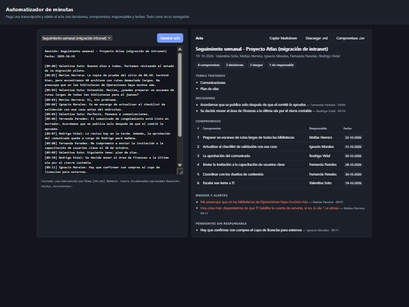

# Automatizador de minutas

Convierte la **transcripción de una reunión** en un **acta estructurada**: asistentes, temas, decisiones, compromisos (con responsable y fecha), riesgos y pendientes que quedaron sin dueño.

**[Ver demo en vivo](https://alansch7.github.io/automatizador-minutas/)**

> Las transcripciones de `ejemplos/` son **ficticias**. Personas, empresas y proyectos fueron inventados para la demo.



## El problema

Escribir el acta después de cada reunión toma tiempo y se posterga. Cuando por fin se envía, muchos compromisos no tienen responsable ni fecha clara. Las herramientas de videollamada ya entregan la transcripción. Lo que falta es convertirla en algo accionable: **quién hace qué y para cuándo**.

## Ejemplo

Entrada (`ejemplos/seguimiento-semanal.txt`):

```text
Reunión: Seguimiento semanal - Proyecto Atlas (migración de intranet)
Fecha: 2026-10-19

[09:03] Valentina Soto: Matías, ¿puedes preparar un escaneo de rutas largas de todas las bibliotecas para el jueves?
[09:04] Ignacio Morales: Yo me encargo de actualizar el checklist de validación con ese caso antes del miércoles.
[09:07] Rodrigo Vidal: Además, la aprobación del comunicado queda a cargo de Rodrigo para mañana.
[09:11] Ignacio Morales: Hay que confirmar con compras el cupo de licencias para externos.
```

Salida (extracto de [`ejemplos/acta-seguimiento-semanal.md`](ejemplos/acta-seguimiento-semanal.md)):

| # | Compromiso | Responsable | Fecha |
|---|---|---|---|
| 1 | Preparar un escaneo de rutas largas de todas las bibliotecas | Matías Herrera | 22-10-2026 |
| 2 | Actualizar el checklist de validación con ese caso | Ignacio Morales | 21-10-2026 |
| 3 | La aprobación del comunicado | Rodrigo Vidal | 20-10-2026 |

y en **Pendientes sin responsable**: *"Hay que confirmar con compras el cupo de licencias para externos"*.

## Cómo usarlo

**En el navegador:** abre `index.html` (o la versión de GitHub Pages), carga un ejemplo o pega tu transcripción y presiona *Generar acta*. Puedes copiar el acta en Markdown o descargar los compromisos en CSV.

**Por línea de comandos** (Node 18+, sin dependencias):

```bash
node src/cli.js ejemplos/seguimiento-semanal.txt                 # acta en Markdown a la consola
node src/cli.js ejemplos/comite-cambios.txt --json               # estructura en JSON
node src/cli.js reunion.txt --salida acta.md --fecha 2026-10-19  # a un archivo
npm test
```

## Qué reconoce

| Elemento | Ejemplos de frases |
|---|---|
| Compromiso en primera persona | "me encargo de…", "me comprometo a…", "quedo con…", "yo preparo…" |
| Compromiso asignado a otro | "Fernanda se encarga de…", "…queda a cargo de Rodrigo", "Matías, ¿puedes…?" |
| Fechas | hoy, mañana, pasado mañana, el jueves, el próximo lunes, la próxima semana, 28 de octubre, 15/11, fin de mes, en dos semanas |
| Decisiones | "acordamos", "se decide", "se aprueba", "quedamos de acuerdo" |
| Riesgos | "riesgo", "me preocupa", "bloqueo", "dependemos de", "se atrasa" |
| Pendientes sin dueño | "hay que…", "falta…", "tenemos que…" |
| Temas | "pasemos a…", "siguiente tema:…", "revisemos…" |

Los nombres cortos se resuelven contra la lista de asistentes: "Matías" pasa a ser "Matías Herrera".

## Decisiones de diseño

- **Reglas deterministas en lugar de un LLM.** Cada compromiso detectado se puede explicar por la frase que lo generó, no hay costo por uso y la transcripción nunca sale del equipo. Si después se quiere más cobertura, se puede agregar un modelo de lenguaje *detrás* de la misma estructura de acta, sin cambiar la salida.
- **Las fechas relativas se resuelven contra la fecha de la reunión**, no contra el día en que se genera el acta. "El jueves" significa el jueves siguiente a la reunión.
- **Lo que no tiene dueño también se reporta.** Muchas veces el problema de una reunión no es lo que se asignó, sino lo que quedó en "hay que…".
- **Cada ítem conserva quién lo dijo y a qué hora**, para poder verificarlo contra la grabación.
- **Un solo módulo para web y CLI** (`src/minutas.js`), testeado con `node:test`.
- **El acta es un borrador.** El pie del acta pide revisarla antes de enviarla: las reglas cubren las formas más comunes de comprometerse, no todas.

## Resultado

Con la transcripción de ejemplo, una reunión de 14 minutos con 5 personas, el acta sale en menos de un segundo. Trae 2 temas, 2 decisiones, 6 compromisos (todos con responsable y fecha resueltos), 2 riesgos y 1 pendiente que quedó sin dueño. En el ejemplo, la gente se compromete de distintas formas: en primera persona, en tercera persona, en voz pasiva y con una pregunta directa ("Matías, ¿puedes…?"). Todas quedan cubiertas por 7 tests automatizados.

## Limitaciones conocidas

- Supone que la transcripción ya identifica al hablante en cada línea.
- Un "¿puedes…?" se toma como compromiso aceptado. No analiza si la otra persona dijo que no.
- Está pensado para español. Las frases fuera de los patrones no se detectan.

## Estructura

```
index.html        interfaz web
src/minutas.js    motor de extracción (puro, sin dependencias)
src/cli.js        línea de comandos
ejemplos/         transcripciones ficticias y acta generada
tests/            tests con node:test
```

## Licencia

MIT
